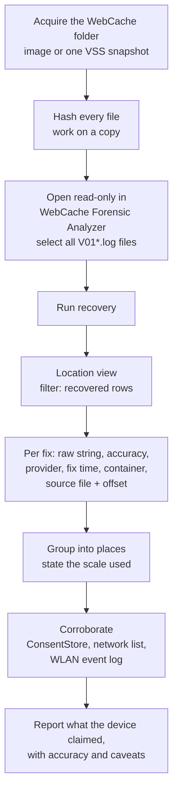

<!--  -->

# Where Was This Laptop? Device Geolocation Hiding in `WebCacheV01.dat`

Windows has no "location history" artifact that you can open and read. There is no table of places the laptop has been.

And yet the taskbar's news and weather feed tells Microsoft's servers where the device is, many times a day, inside ordinary request URLs. `WebCacheV01.dat` caches those requests. Within hours the live records are gone, but the coordinates are usually still in the database's free pages and transaction logs, sometimes going back more than a year.

This post covers:

- where those positions come from
- how to recover them with [WebCache Forensic Analyzer](https://github.com/akhil-dara/WebCache-Forensic-Analyzer) by Akhil Dara
- how to read a fix without overstating it
- how to corroborate it from the registry with RegRipper's `consentstore` plugin

> **TL;DR**
> - **Artifact:** `%LOCALAPPDATA%\Microsoft\Windows\WebCache\WebCacheV01.dat`, plus its `V01*.log` transaction logs
> - **Source:** Widgets / Microsoft Start feed requests to `assets.msn.com` that carry `clientLocation=lat|lon`
> - **Catch:** live records rotate within hours, so the positions are usually found **only in recovered records**
> - **Tool:** WebCache Forensic Analyzer → **Location** view, with recovery enabled
> - **Corroborate:** `ConsentStore\location` in `NTUSER.DAT` shows when the Widgets app last used location
{: .prompt-tip }

## There Is No Location Table

`WebCacheV01.dat` is an ESE (Extensible Storage Engine) database. Windows uses it to cache web and app activity for Internet Explorer, legacy Edge, and the many Windows components and packaged apps that use the same cache. Each app gets its own **container**, a table with its own cache directory.

None of those tables holds locations. What the cache does hold is **request URLs**. When an application puts the device's position in a URL, the cache keeps that position as a side effect.

The database never sits alone. Collect everything in the folder:

| File | Role |
|---|---|
| `WebCacheV01.dat` | The ESE database itself |
| `V01.log`, `V01xxxxx.log` | Transaction logs: recent changes not yet flushed, and older records |
| `V01.chk` | Checkpoint: how far the logs have been applied |
| `V01res00001.jrs`, `V01res00002.jrs` | Reserved log files |
| `WebCacheV01.jfm` | Flush map |

The database is held open while the user is logged on. A live copy is locked, and an acquired copy is almost always in a **dirty-shutdown** state, with recent changes still sitting in the logs.

## How a Position Ends Up in the Cache

{: w="1200" h="610" }
_The device's position travels inside a feed request URL, and the cache keeps the URL._

1. **Windows locates itself.** The location service resolves the WiFi access points the laptop can hear into a fix: latitude, longitude and an accuracy radius.
2. **Widgets refreshes.** The taskbar's news and weather feed refreshes from `assets.msn.com` throughout the day, whether or not anyone opens the panel. On Windows 11 two packages are involved:
   - `MicrosoftWindows.Client.WebExperience_cw5n1h2txyewy`, the Widgets board
   - `Microsoft.StartExperiencesApp_8wekyb3d8bbwe`, the Microsoft Start feed
3. **The request carries the fix.** When the device's location is available to the app, the request URL includes it.
4. **The cache records it.** `WebCacheV01.dat` stores:
   - the URL
   - its cache times
   - the response headers
   - the name of the file the response was saved to, in the app's own `Packages\...\AC\INetCache\` folder

## Anatomy of the Request

{: w="1200" h="590" }
_Illustrative values. The parameter names are documented by WebCache Forensic Analyzer._

| Parameter | What it holds | Why it matters |
|---|---|---|
| `clientLocation` | Latitude and longitude, joined by `\|` | The position the device reported |
| `clientLocationAccuracy` | The accuracy radius the device claimed, in metres | Decides how far the fix can be pushed in a report |
| `clientLocationProvider` | How the device got the position, e.g. `WiFi` | Satellite, WiFi and network fixes support very different conclusions |
| `clientLocationTimestamp` | When the device took the fix (UTC) | Can differ from when the cache wrote the record |

The feed is the main source, but it is not the only one. Maps, weather and ad requests also put positions in URLs, under names such as `lat`/`lon`, `latlng`, `ll` or `coords`. The tool reads all of these. It ignores integer pairs, out-of-range values and `0,0`, which is "null island", almost always a default rather than a real position.

## Why the Live Tables Come Back Empty

The feed records are short-lived. The cache replaces them within hours, and the response files in `INetCache` rotate with them. Read only the live tables, and the Location view is usually **empty**.

But deletion is not erasure. Removed records stay in unallocated database pages and in the transaction logs, and that is where the positions survive.

{: w="1200" h="660" }
_Data from the WebCache Forensic Analyzer documentation: one Windows 11 machine, three points in time._

| Copy examined | Feed requests, live | Feed requests, recovered | Positions, live | Positions, recovered |
|---|--:|--:|--:|--:|
| Shadow copy, day 1 | 23 | 145 | 0 | 135 |
| Shadow copy, day 2 | 0 | 172 | 0 | 135 |
| Live system, day 2 | 5 | 167 | 0 | 135 |

**Not one position was ever in a live record.** All 135 were recovered, from requests made over more than a year.

> Do not "fix" the evidence copy before you parse it.
> - `esentutl /p` (repair) can destroy the records you need.
> - `esentutl /r` (soft recovery) writes the logs into the database.
>
> Work on a hashed copy, and use a parser that reads the dirty database **as found**.
{: .prompt-danger }

## Acquisition: Take the Whole Folder, From One Point in Time

The database and its logs have to come from the **same moment**. A `.dat` file from one snapshot with logs from another tells an inconsistent story. Take the folder from a forensic image, or from a single Volume Shadow Copy:

```cmd
:: elevated prompt: list the snapshots, then expose one as a folder
vssadmin list shadows
mklink /d C:\vss1 \\?\GLOBALROOT\Device\HarddiskVolumeShadowCopy1\

:: copy the whole WebCache folder from that snapshot
robocopy "C:\vss1\Users\<user>\AppData\Local\Microsoft\Windows\WebCache" "D:\Case\WebCache_VSC1" /E /COPY:DAT /R:0
```

Every shadow copy is another point in time. As the table above shows, consecutive snapshots can hold different live records, while the recovered positions persist across them.

## Recovering the Positions with WebCache Forensic Analyzer

[WebCache Forensic Analyzer](https://github.com/akhil-dara/WebCache-Forensic-Analyzer) is a Windows desktop application built for exactly this database. Its design rules map directly onto the problems above:

- **It reads dirty databases as they are.** There is no repair, no soft recovery and no writes. Every file it reads is hashed with SHA-256 when opened.
- **It recovers deleted and unflushed records** from unallocated pages and the transaction logs. Each recovered record carries its source file, byte offset, recovery method and confidence, and stays visibly apart from live records.
- **It gets both clocks right.** Some containers store UTC and others the machine's local time without saying so. Each timestamp is shown both ways, using the time zone recovered from the evidence.
- **Its Location view** reads every request URL, live and recovered, for a position, and keeps the raw strings beside the parsed numbers so each finding can be checked against the stored URL.
- **Its Containers view** names which app each record belongs to, so a position can be tied to the Start Experiences app's own container.
- **Nothing is looked up.** No network request is made, and the map links are text.

The workflow:

1. Open the copied `WebCacheV01.dat`. The tool lists the logs and checkpoint beside it; select them all.
2. Let recovery run, then open **Location**.
3. Filter to recovered rows. For this artifact, that is usually where every position is.
4. For each fix, record:
   - the raw `clientLocation` string
   - its accuracy, provider and fix time
   - the container it came from
   - the source file and byte offset of the recovered record
5. Export with the filters in force. CSV, Excel, JSON, SQLite, PDF and a self-contained HTML report each carry a provenance record and SHA-256 hashes.

Releases for Windows 10/11 (64-bit) are on the [releases page](https://github.com/akhil-dara/WebCache-Forensic-Analyzer/releases/latest). The builds are not code-signed, so verify the download against `SHA256SUMS.txt` before running it on an analysis machine.

## Reading a Fix Honestly

{: w="1200" h="660" }
_Accuracy bands and grouping example from the WebCache Forensic Analyzer documentation._

A coordinate in a URL is **observed**: the digits are in the stored record. What it establishes is narrower than it looks: **the device told a server it was here.** It does not establish that a particular person was there.

| Accuracy | Typical source | What it supports |
|---|---|---|
| About 30 m or better | Satellite fix | A specific spot |
| Up to about 200 m | WiFi or cell positioning | A building, not a room |
| Beyond 200 m | Coarse positioning | A neighbourhood at best |

A provider of `WiFi` means Windows positioned itself from the access points it could hear, by asking Microsoft's location service. Akhil Dara's [WiFi Geolocation Forensics](https://github.com/akhil-dara/wifi-geolocation-forensics) shows how that backend works. It also covers a caveat: when Microsoft holds no record for the access points heard, it can answer from the network connection instead.

**From fixes to places.** A laptop that sits on the same desk produces many near-identical fixes. The tool groups them at a scale you choose: 11 m, 110 m (the default, matching typical WiFi accuracy) or 1.1 km.

A place is the position reported most often in its area, plus every fix within that distance of it. Each place:

- is labelled by a position that was actually reported
- states its range of accuracies, never an average

In the documented example, the 135 fixes formed **5 places** at 110 m. Two of them held 68 and 62 fixes. At 11 m, the same fixes split into **27 places** from ordinary WiFi jitter. Grouping by rounding instead of distance cut both large places in two along a grid line.

> State the accuracy, the provider and the grouping you used next to every location finding. "Between March and June the device reported, 41 times and via WiFi, positions consistent with the office building (accuracy about 64 m)" survives cross-examination. "The suspect was at the office" does not.
{: .prompt-warning }

## Corroborate with ConsentStore

The cache tells you **where** the device said it was. The registry tells you **which app used location, and when**. Both live in the user's hive:

```text
NTUSER.DAT\Software\Microsoft\Windows\CurrentVersion\CapabilityAccessManager\ConsentStore\location
SOFTWARE\Microsoft\Windows\CurrentVersion\CapabilityAccessManager\ConsentStore\location
```

On my own Windows 11 machine, the entries looked like this:

| Key under `ConsentStore\location` | Values | Meaning |
|---|---|---|
| *(the `location` key itself)*, in both hives | `Value` = `Allow`, `LastSetTime` | Location services allowed for this user and for the device, and when that was last changed |
| `Microsoft.StartExperiencesApp_8wekyb3d8bbwe` | `Value` = `Prompt`, `LastSetTime` | Permission state for the feed app |
| `MicrosoftWindows.Client.WebExperience_cw5n1h2txyewy` | `LastUsedTimeStart`, `LastUsedTimeStop` | **When the Widgets board last used location** |

RegRipper's `consentstore` plugin reads these. This is its output from a test `NTUSER.DAT` built with the same structure (the times are illustrative):

```text
C:\RegRipper4.0>rip.exe -r NTUSER.DAT -p consentstore
consentstore v.20261017
(Software, NTUSER.DAT) Gets contents of ConsentStore subkeys
MITRE: T1123 & T1125 (collection)

location
MicrosoftWindows.Client.WebExperience_cw5n1h2txyewy
LastWrite time       2026-10-16 08:41:07Z
LastUsedTimeStart    2026-10-16 08:41:05Z
LastUsedTimeStop     2026-10-16 08:41:07Z
```

And for a timeline:

```text
C:\RegRipper4.0>rip.exe -r NTUSER.DAT -p consentstore_tln
1792140065|REG|||ConsentStore location "MicrosoftWindows.Client.WebExperience_cw5n1h2txyewy" LastUsedTimeStart
1792140067|REG|||ConsentStore location "MicrosoftWindows.Client.WebExperience_cw5n1h2txyewy" LastUsedTimeStop
```

How to use it:

- **Permission windows.** If `location` was set to `Deny` for a period (see `LastSetTime`), no feed positions should exist for that period. If positions do show up, find out why.
- **Last use.** A `LastUsedTime` for the Widgets package that lines up with the newest recovered fix time is independent corroboration from a different store.
- **Only the last session survives.** ConsentStore keeps one start/stop pair per app. It is a point, not a history, so the recovered fixes provide the history.

I have proposed an update to RegRipper's `consentstore` plugin. With it, the plugin also reports the `Value` and `LastSetTime` values, and keeps entries with a `LastUsedTimeStop` of 0: an app that was still using the device when the hive was collected, which the current version drops. The timeline plugin also stops printing those zero values as 1970 events.

Two more places to cross-check a location claim:

- **The registry's network list**, read with the RegRipper `networklist` plugin, shows the networks the machine joined, with first and last connection times.
- **The `Microsoft-Windows-WLAN-AutoConfig/Operational` event log** records WiFi connections and disconnections.

## Examiner Workflow



## What a Feed Record Is, and Is Not

- **It shows that a request was made.** The feed refreshes in the background, so it does not show that anyone opened the Widgets panel or read it.
- **The response is not in the database.** The response is a separate file in the app's cache, and the record only names it. A place that the *server* put in its response was chosen by the server, not reported by the device.
- **The database stores no request or response bodies.** It holds only URLs, times, file references and headers.
- **The position is what the device claimed.** It can be wrong, and it can be overridden or spoofed. Always report it with its accuracy and provider.
- **No positions is not proof of no movement.** Location may have been off, Widgets may have been disabled, or the app may not have had permission.

## Key Takeaways

- `WebCacheV01.dat` has no location table, but the Widgets feed puts the device's latitude and longitude into request URLs, and the cache keeps them
- Live feed records rotate within hours. In the documented example, **every** position came from recovered records, so a parser without recovery shows nothing
- Collect the database **and** its transaction logs from one point in time, hash them, and never repair the evidence copy
- Each fix carries an accuracy, a provider and a fix time. Report all three, and say "the device reported", not "the person was"
- Group fixes into places by distance (around 110 m for WiFi), and state the scale you used
- Corroborate with `ConsentStore\location` (RegRipper `consentstore`), the network list and the WLAN event log

## Credits

This post is built on the research and tooling of **[Akhil Dara](https://github.com/akhil-dara)**:

- **[WebCache Forensic Analyzer](https://github.com/akhil-dara/WebCache-Forensic-Analyzer)**, a forensic examiner for `WebCacheV01.dat` with dirty-database parsing, record recovery and the Location view (AGPL-3.0)
- **[Location in WebCacheV01.dat](https://github.com/akhil-dara/WebCache-Forensic-Analyzer/blob/main/docs/how-location-is-found.md)**, the source of the parameter details, recovery figures, accuracy bands and grouping example used here
- **[WiFi Geolocation Forensics](https://github.com/akhil-dara/wifi-geolocation-forensics)**, which shows how Windows turns the WiFi access points it hears into a position

Thanks also to **Harlan Carvey** for [RegRipper](https://github.com/keydet89/RegRipper4.0) and its `consentstore` plugin.

## References

- [WebCache Forensic Analyzer: How it works](https://github.com/akhil-dara/WebCache-Forensic-Analyzer/blob/main/docs/architecture.md)
- [WebCache Forensic Analyzer: Validation](https://github.com/akhil-dara/WebCache-Forensic-Analyzer/blob/main/docs/validation.md)
- [RegRipper 4.0](https://github.com/keydet89/RegRipper4.0) (`consentstore`, `consentstore_tln` and `networklist` plugins)
- [Can you track processes accessing the camera and microphone?](https://medium.com/@7a616368/can-you-track-processes-accessing-the-camera-and-microphone-7e6885b37072), the ConsentStore reference cited by the `consentstore` plugin

---


