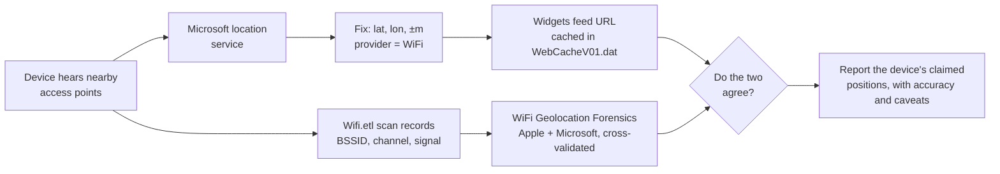

<!--  -->

# Where Is This Access Point? Geolocating a WiFi BSSID, the Forensic Way

In the [previous post](/posts/webcache-geolocation/), the Widgets feed's location requests carried `clientLocationProvider=WiFi`. Windows had located itself from the access points it could hear, by asking Microsoft's location service.

This post turns that question around. Say a BSSID turns up in evidence: in a WiFi trace, a scan export or a SIEM log. **Where is that access point?**

[WiFi Geolocation Forensics](https://github.com/akhil-dara/wifi-geolocation-forensics), by [Akhil Dara](https://www.linkedin.com/in/akhil-dara/), answers it the way an examiner needs it answered:

- **two independent providers**, each giving its own position
- **cross-validation** between them, with a score you can argue with line by line
- **every byte exchanged** sealed into an evidence package that verifies itself

> **TL;DR**
> - **Input:** one or more BSSIDs (access point MAC addresses), not network names
> - **Providers:** Apple answers *per access point*; Microsoft answers *for the whole fingerprint*. They are independent, so agreement between them is real corroboration
> - **Traps it catches:** Microsoft's IP-based fallback, Apple's `-180, -180` "never seen" sentinel, randomised MACs, and client radios mistaken for access points
> - **Output:** a verdict (`CORROBORATED` … `UNRESOLVED`), an HTML/PDF report and a SHA-256-sealed evidence ZIP with its own verifier
> - **Remember:** the enquiry is visible to Apple and Microsoft, and the position is a crowd-sourced record, not a measurement
{: .prompt-tip }

## Why a BSSID Can Be Located at All

A **BSSID** is the MAC address of one radio on an access point. A dual-band router usually has two, one for 2.4 GHz and one for 5 GHz. The **SSID** is just the network name, and thousands of networks share names like `Home` or `Reception WiFi`.

Phones and laptops with location services report the access points they hear, together with their own position. Apple and Microsoft each aggregate those reports into a database that maps BSSIDs to places. That is what lets a device locate itself without GPS. It also means that **a BSSID can be positioned, but an SSID cannot**: neither provider accepts a network name.

## Two Providers, Two Different Questions

{: w="1200" h="660" }
_Apple and Microsoft answer different questions from different data, which is what makes their agreement meaningful._

| | Apple Location Services | Microsoft Location Inference |
|---|---|---|
| **Question asked** | "Where is *this access point*?" | "Where is *the device that hears all of these*?" |
| **Answer** | A position and accuracy for each access point | One multilaterated position with a radial uncertainty |
| **Extra** | Returns the target plus up to **400 neighbouring** access points | Re-run over **disjoint groups** of beacons (default 4) as independent replicates |
| **No record** | Comes back as `-180, -180`, a sentinel | Silently answers from **your IP address** |

The two databases are built separately, by different methods. When both land on the same spot within their stated uncertainty, that is **corroboration**, not one source repeating itself. That idea is the basis of the whole confidence model.

One detail shows how carefully the tool was tested against the live services. According to its changelog, the request fragment that public implementations copy limits Apple's neighbour harvest to a **single** access point. Omitting that field returns 400.

## Where the BSSIDs Come From on Windows

{: w="1200" h="610" }
_What a Windows host actually keeps, as measured and documented in the tool's source._

This is the most useful section of the tool's source for any Windows examiner, because two widely repeated assumptions turn out to be wrong:

| Source | What it holds | BSSID? |
|---|---|---|
| **NetworkList** `Signatures\Unmanaged` | `DefaultGatewayMac`: the **gateway's** MAC, not the access point's. On a combined router the two addresses are often one or two values apart, so it points at the right box and still resolves to nothing | No |
| **NetworkList** `Profiles` | `DateCreated` / `DateLastConnected`: a dated list of network names, without positions | No |
| **WLAN-AutoConfig** events 8000–8011, 11000–11010 | `SSID`, `ProfileName` and `LocalMac`, which is **this machine's own radio** | No |
| **`Wifi.etl`** (`WiFiSession` autologger) | The BSSIDs audible in each scan, with channel and signal strength. A circular buffer of about 8 MB, so **hours rather than months** | **Yes** |

The tool reads `C:\Windows\System32\LogFiles\WMI\Wifi.etl` directly, with no Windows dependency, so it works on an image from any analysis OS. It also accepts:

- saved `netsh wlan show networks mode=bssid` output
- Kismet and WiGLE CSV
- SIEM / Sentinel exports
- plain lists in any notation (`00:00:5e:00:53:a6`, `00-00-5E-00-53-A6`, `0000.5e00.53a6`, …)

Addresses that belong to the host's own adapter are recognised and excluded.

## Running It

There is nothing to `pip install`. The tool is pure Python standard library (3.9+): the protobuf codec, the PNG encoder and the PDF writer are all part of the project.

```bash
git clone https://github.com/akhil-dara/wifi-geolocation-forensics
cd wifi-geolocation-forensics
python3 -m wifigeo            # opens the local web interface (loopback only)
```

On an evidence workstation without Python, the portable Windows build from the [releases page](https://github.com/akhil-dara/wifi-geolocation-forensics/releases) bundles its own runtime. Extract it and double-click `WGF.cmd`.

A single enquiry from the command line looks like this. The address is from the documentation range, and the output is abridged from the project's README:

```text
$ python3 -m wifigeo --bssid 00:00:5e:00:53:20 --ssid "Reception WiFi"

[ 40%] apple       Apple returned 401 access points (401 with positions)
[ 53%] microsoft   Microsoft resolved 51.500000, -0.120000 (+/-131.0 m)
[ 55%] microsoft   4 of 4 groups resolved independently; they agree to within 40 m
[ 70%] analysis    Verdict: CORROBORATED (91/100, coverage 100%)
[100%] done        Complete. 84 exhibits, root hash 1be277a47790c429

  Verdict   : CORROBORATED  (90.7/100, 100.0% of checks run)
  Position  : 51.500000, -0.120000  +/- 35.2 m
  Report    : evidence\CASE-20260804T054958Z-5DC525_REPORT.html
  Evidence  : evidence\CASE-20260804T054958Z-5DC525_EVIDENCE.zip
```

The options that matter most in casework:

| Option | Use it for |
|---|---|
| `--bssid MAC` (repeatable) | Give both radios of a dual-band network; each is an independent lookup |
| `--import FILE` | Saved `netsh` output, Kismet/WiGLE/SIEM CSV, or a plain list |
| `--host-artefacts` | Locate every network this machine has joined (Windows, elevated) |
| `--observed-at ISO8601` | State when the beacon was *seen*, not when you looked it up |
| `--redact` | Produce a shareable copy of the report |
| `--no-microsoft`, `--no-enrichment`, `--no-tiles` | Narrow who learns about the enquiry (see OPSEC below) |

When imported addresses fall in more than one place, the tool reports a **location history**, one entry per place with first and last seen dates, instead of averaging everything into one meaningless coordinate.

## Answers That Look Right, and Aren't

{: w="1200" h="600" }
_Drawn from the project's changelog and source: each would put a confident but wrong position into a report._

- **Microsoft's IP fallback.** When Microsoft has no record for the beacons, it answers anyway, with a position derived from the *examiner's own internet connection*. The only signs are `Source="IP"` and an uncertainty of tens of kilometres. It looks like corroboration, but it describes **you**. The tool detects it and discards it.
- **Apple's sentinel.** An access point Apple has never seen comes back at exactly `-180.0, -180.0`. That is a placeholder and must never be plotted.
- **Randomised MACs.** A locally administered address is not assigned by a manufacturer and is not globally unique, so unrelated devices can share it, and a database hit may describe someone else. These addresses are penalised, and collisions are excluded with a stated reason.
- **Client radios and GUIDs.** Exports carry `LocalMac` (the host's own adapter), and GUIDs look like MAC addresses. Geolocating either invents an access point that never existed.

> The project's security policy treats these as **security issues, not bugs**: "silent misattribution". A wrong answer that looks right is worse than a crash, because it reaches a report.
{: .prompt-info }

## A Confidence Score You Can Argue With

{: w="1200" h="726" }
_Named checks with their weights, the penalties, and the verdict bands._

The verdict is not a black-box number. It is the sum of **nine named, weighted checks**, from cross-provider agreement (25) to multi-radio consistency (5), minus **four penalties**, such as −15 for a randomised MAC. Every line is printed in the report with its contribution, so a reviewer can dispute one check instead of the whole result.

Two rules keep it honest:

1. **A check that could not run is excluded, not scored zero.** An unreachable provider says nothing about the position, so it leaves the denominator, and the report states what share of the checks actually ran.
2. **`CORROBORATED` requires two providers that actually agreed.** If only one answered, the verdict is capped at `SINGLE-SOURCE`, however good everything else looks.

| Score | Verdict | Meaning |
|---|---|---|
| 85+ | `CORROBORATED` | Two independent providers agree within their stated uncertainty |
| 70+ | `SUPPORTED` | Well supported, with a minor reservation |
| 50+ | `INDICATIVE` | Plausible, but corroboration is incomplete |
| 30+ | `WEAK` | Treat as a lead only |
| below 30 | `UNRESOLVED` | The evidence does not support a position |

## Every Byte Is Evidence

{: w="1200" h="640" }
_The sealed package, its verifier, and the redacted copy for sharing._

Requests and responses are written to disk **before** analysis. If the run crashes halfway, whatever was already collected stays intact and verifiable.

- **One exhibit per HTTP transaction**, in both directions: the gzip actually sent, the response exactly as received, a decoded copy of each, and a `meta.json` with SHA-256 hashes.
- **`manifest.json`** lists the SHA-256 of every file, and **`MANIFEST.sha256`** holds a single root hash over that manifest. Changing, adding or removing any file changes the root.
- **`verify_evidence.py`** ships inside the package. It needs only Python, not the tool and not the internet. Change one byte and it names the file:

```text
$ python3 verify_evidence.py
MODIFIED: exhibits/0001_apple.wloc.batch01/response.body.wire.bin
RESULT: FAILED - package does not verify
```

**Sharing a result:** `--redact` writes a distributable copy of the report:

- **Addresses** show the vendor prefix only.
- **Coordinates** are **truncated, not scrambled**, so a reader can see the precision was reduced instead of being handed a plausible fake.
- **Derived encodings** such as Plus Code, MGRS and geohash are rebuilt from the truncated value, not just masked.
- **The root hash** is still quoted, so the redacted copy can be tied back to the evidence.

The sealed package itself is never redacted.

## OPSEC: Your Enquiry Is Not Invisible

There are no API keys and no accounts, but that does not make the traffic invisible. From the project's security policy:

| Service | Receives | When |
|---|---|---|
| `gs-loc.apple.com` | the access point addresses you ask about | every run |
| `inference.location.live.net` | the same addresses, as a beacon fingerprint | unless `--no-microsoft` |
| OpenStreetMap services (Nominatim, Overpass, Photon, tiles) | the resolved coordinates | unless `--no-enrichment` / `--no-tiles` |
| `api.mylnikov.org`, `wifidb.net` | the access point addresses | corroboration lookups |

> - Apple and Microsoft learn **which access point you are interested in, and when**. If the subject can see those logs, the enquiry is not covert.
> - Microsoft's IP fallback means the request **reveals your connection's location**, even though the tool discards the answer.
>
> Run enquiries from a dedicated analysis connection, and narrow the footprint with the `--no-*` flags when context matters less than discretion.
{: .prompt-warning }

## Limits: Read These Before You Testify

- **A network name alone cannot be positioned.** An SSID has to be resolved to BSSIDs by a radio that can hear it, which means yours. Out of range is out of reach.
- **These positions are not measurements.** They are crowd-sourced records of where an access point was observed, at an unstated earlier time.
- **Access points move.** A relocated router or a mobile hotspot keeps its old recorded position until the database catches up, and neither provider timestamps its records.
- **Absence is not proof of absence.** No record only means no contributing device ever reported it.
- **Addresses can be forged**, so a hit can be induced deliberately.

Findings are **investigative leads**. Corroborate them by independent means.

## Responsible Use

This is the uncomfortable part, and the project states it plainly. Locating a physical place from a hardware identifier is legitimate and often necessary in incident response, threat intelligence and criminal investigation. **It is also the mechanism of stalking.**

- **Have lawful authority** for every lookup. Wireless positioning data is personal data in most jurisdictions.
- **The fact that Apple and Microsoft answer without a credential is not authorisation.**
- **Treat host artefacts with care.** `--host-artefacts` and `--import` on a subject machine produce a **movement history**.

## How It Connects to WebCache Geolocation

The two posts describe two independent routes to the same question: *where was this device?*



The two routes are worth keeping straight:

- **WebCache gives you what the device itself reported.**
- **WiFi Geolocation Forensics tells you where the access points it heard are recorded.**

When both land in the same place, the finding stands on two different artifacts and two different databases.

## Key Takeaways

- A **BSSID** can be geolocated; an **SSID** cannot. Neither provider accepts network names
- Apple (per access point) and Microsoft (fingerprint multilateration) are **independent**, so their agreement is genuine corroboration
- On Windows, **`Wifi.etl`** holds scanned BSSIDs. NetworkList's `DefaultGatewayMac` is the gateway, and WLAN-AutoConfig events carry no peer address
- Watch for **plausible-but-wrong** answers: IP fallback, the `-180` sentinel, randomised MACs, and client adapters
- The verdict is a **transparent rubric**, capped at `SINGLE-SOURCE` without a real second opinion
- Every exchange is **sealed and self-verifying**, and redacted copies truncate rather than fake
- The enquiry is **visible** to the providers. Positions are **leads, not measurements**, and they need lawful authority

## Credits

This post is built entirely on the research and tooling of **[Akhil Dara](https://www.linkedin.com/in/akhil-dara/)**:

- **[WiFi Geolocation Forensics](https://github.com/akhil-dara/wifi-geolocation-forensics)** (MIT): BSSID geolocation through two independent providers, with cross-validation, a transparent confidence score and hash-verified evidence packages
- **[WebCache Forensic Analyzer](https://github.com/akhil-dara/WebCache-Forensic-Analyzer)**, the tool behind the [previous post](/posts/webcache-geolocation/)

The provider behaviour, Windows artifact measurements, scoring rubric and package layout described here come from the project's README, source, changelog and security policy. Example output uses the project's documentation-range address.

## References

- [WiFi Geolocation Forensics: README](https://github.com/akhil-dara/wifi-geolocation-forensics#readme)
- [Security and responsible use](https://github.com/akhil-dara/wifi-geolocation-forensics/blob/master/SECURITY.md), covering what the tool sends and to whom
- [Changelog](https://github.com/akhil-dara/wifi-geolocation-forensics/blob/master/CHANGELOG.md), which lists the plausible-but-wrong answers found against the live services
- [Where Was This Laptop? Device Geolocation Hiding in WebCacheV01.dat](/posts/webcache-geolocation/)

---


